<h1 align="center">readme-terminal</h1>

<p align="center">
  An animated terminal for your GitHub profile README.<br>
  One Python file, zero dependencies, one SVG that lives in your repo.
</p>

<p align="center">
  
</p>

## Why

- **Zero dependencies.** Only the Python standard library. Nothing to `pip install`.
- **No external service.** Most typing widgets are loaded from someone else's server. This one is a file in your repo, so it never goes down and never hits a rate limit.
- **Feels like a real terminal.** Commands are typed one by one, output shows up when the command finishes, and a cursor blinks at the end.
- **Three window styles.** Windows, Linux (GNOME/Ubuntu) and macOS, with any colors you want.
- **Made for GitHub.** Pure SVG animation (SMIL): no JavaScript, no CSS keyframes, no embedded fonts. It runs inside a plain `` tag.

## Quick start

**1. Get the script.** It is a single file:

```bash
curl -O https://raw.githubusercontent.com/ExplorerOf/readme-terminal/main/terminal_svg.py
```

**2. Write a config.** Start from one of the examples ([Windows](example.json), [Linux](example-linux.json), [macOS](example-mac.json)) and save it as `terminal.json`.

**3. Generate the SVG:**

```bash
python terminal_svg.py terminal.json > terminal.svg
```

**4. Show it.** Commit `terminal.svg` to your profile repo (the one named after your username) and add this to its `README.md`:

```html

```

Requires Python 3.7 or newer.

## Styles

### `windows` (default)

The one at the top of this page: Windows Terminal title bar, `C:\>` prompt, green on black.

### `linux`

GNOME/Ubuntu look: centered bold title and round buttons on the right.



### `mac`

<details>
<summary>macOS look: traffic-light buttons on the left. Click to see it.</summary>
<br>

</details>

## Writing the config

The config is a JSON file. Everything has a default, so the smallest config is just `lines`:

```json
{
  "style": "linux",
  "title": "explorer_of@ubuntu: ~",
  "prompt": "explorer_of@ubuntu:~$ ",
  "lines": [
    {"cmd": "whoami"},
    "explorer_of",
    "",
    {"cmd": "cat stack.json"},
    "{ \"languages\": [\"TypeScript\", \"Python\"] }"
  ]
}
```

### Lines

| You write | You get |
|-----------|---------|
| `{"cmd": "whoami"}` | The prompt, then `whoami` typed letter by letter |
| `"any text"` | An output line, shown once the command above it is typed |
| `""` | A blank line |

A blinking cursor is added after the last line for you. Spaces are kept as typed, so you can line up columns like a real `ls -l`, `ps` or `tasklist`.

### All options

| Key | Default | What it does |
|-----|---------|--------------|
| `style` | `"windows"` | Window chrome: `"windows"`, `"linux"` or `"mac"` |
| `title` | `"user@host"` | Text in the title bar |
| `prompt` | `"$ "` | Shown before every command |
| `lines` | `[]` | What happens in the terminal (see above) |
| `theme` | green on black | Colors, see below |
| `typing_speed` | `12` | Characters typed per second |
| `pause` | `0.5` | Seconds between the end of a command and its output |
| `width` | `800` | Width in pixels; the height grows with the number of lines |
| `font_size` | `14` | Font size in pixels |
| `line_height` | `21` | Distance between lines in pixels |
| `char_width` | `7.7` | Pixels per character, used to pace the typing (7.7 matches Consolas at 14 px) |

### Themes

`theme` takes six colors. Any you leave out keep the default.

| Key | Colors |
|-----|--------|
| `bg` | Terminal background |
| `bar` | Title bar |
| `border` | Window border |
| `cmd` | Prompt and typed commands |
| `out` | Output lines |
| `title` | Title bar text |

Ready to copy:

| Look | `"theme"` |
|------|-----------|
| Classic green (default) | `{"bg": "#0c0c0c", "bar": "#202020", "border": "#3a3a3a", "cmd": "#39ff14", "out": "#21c421", "title": "#d0d0d0"}` |
| Ubuntu | `{"bg": "#300a24", "bar": "#2c2c2c", "border": "#454545", "cmd": "#8ae234", "out": "#eeeeec", "title": "#eeeeec"}` |
| GitHub dark | `{"bg": "#0d1117", "bar": "#161b22", "border": "#30363d", "cmd": "#e6edf3", "out": "#8b949e", "title": "#8b949e"}` |

## How it works

1. Every command sits behind an invisible clipping rectangle. When its turn comes, the rectangle grows at `typing_speed` characters per second, and that looks like typing.
2. When the command is done, the clipping is removed, so the whole line shows whatever font the visitor has.
3. After `pause`, the output lines appear one every 0.1 s, and the next prompt appears.
4. The script works out all the timings from your lines. Add or remove a line and everything else moves along with it, no manual tweaking.

All of it is SVG `<animate>` and `<set>`. Browsers play those even inside an ``, which is the only way GitHub shows images in a README.

## Tips

- **Update not showing?** GitHub caches images for about five minutes. Point to `terminal.svg?v=2` and bump the number on every update.
- **Line length.** Keep lines under about 90 characters at the default 800 px width (Linux and Mac fonts are wider than Consolas), or raise `width`.
- **Fonts.** The text uses the visitor's own monospace font: Consolas, Cascadia Mono, Menlo or the system default.
- **Accents.** The config is UTF-8, so `ção` and `ñ` work. Emoji also work but are wider than one character and can push aligned columns out of place.
- **Light and dark mode.** The terminal brings its own background, so it looks the same in both GitHub themes.
- **Two languages.** Write one config per language and generate one SVG for each, for example `terminal.svg` and `terminal.en.svg`.

## Development

```bash
python test_terminal_svg.py
```

The test renders every `example*.json`, checks that each command starts hidden, and fails if an example SVG is out of date. After changing the code, regenerate them:

```bash
for f in example example-linux example-mac; do python terminal_svg.py $f.json > $f.svg; done
```

## License

[MIT](LICENSE)
